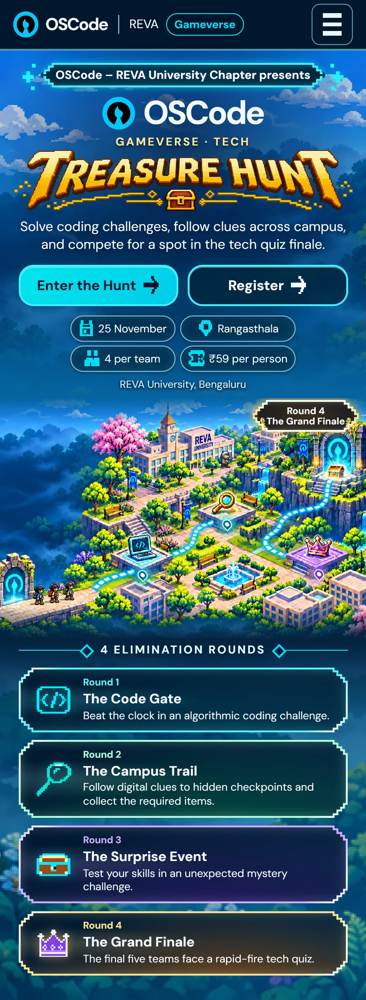

# Gameverse · Tech Treasure Hunt

An interactive pixel-art campus map for Gameverse, the gaming week presented by the OSCode REVA University Chapter.

| Event details | |
| --- | --- |
| Date | 25 November |
| Venue | Rangasthala, REVA University, Bengaluru |
| Team size | 4 members |
| Entry fee | ₹59 per person |
| Registration | [Tech Treasure Hunt registration form](https://forms.gle/Wj2UKVH4vcDYMVmHA) |


<details>
<summary>Mobile view</summary>



</details>

## Run locally

Requirements are Node.js **20.9 or later** and npm. Use the included lockfile to install dependencies.

```bash
git clone https://github.com/Akif-Sait/oscodehunt.git
cd oscodehunt
npm ci
npm run dev
```

Open [http://localhost:3000](http://localhost:3000). In PowerShell, use `npm.cmd` in place of `npm` if your execution policy blocks the npm script.

To run the production build locally, stop any server using port 3000, then run the following commands.

```bash
npm run build
npm start
```

## Explore the campus

- The map includes the REVA entrance, four round landmarks, waterfalls, and a fountain. The Grand Finale is marked by the portal set into the cliff.
- The scene uses layered pixel art, mist, animated portal lighting, water reflections, birds, and drifting leaves that react to the pointer.
- The desktop composition fits the viewport. Phones get an illustrated, vertically scrolling layout with a compact menu and stacked round cards.
- Motion pauses when the tab is hidden. The page also respects the system’s reduced-motion preference.

| Round | Challenge |
| --- | --- |
| 1 · The Code Gate | Solve an algorithmic coding challenge within the time limit. |
| 2 · The Campus Trail | Follow digital clues, find hidden checkpoints, and collect the required items. |
| 3 · The Surprise Event | Take on a mystery challenge that tests your skills in an unexpected way. |
| 4 · The Grand Finale | The final five teams face a rapid-fire tech quiz to decide the champions. |

### Easter eggs

- **Wandering professor.** Watch the upper path between buildings. Click or tap the professor while he’s visible to change what he says in his speech bubble.
- **Fountain fish.** Watch the central fountain for a jump, or click or tap the basin to make the fish leap.
- **The Round 1 laptop.** The three backpackers wait by the entrance until a page event starts their walk. A second event makes the laptop pull them through cyan pixel rings and off the map.

## Token verification handoff

**Enter the Hunt** opens the token prompt on the homepage. The frontend module is in [`app/login/`](app/login/). Its [API adapter](app/login/verify-token.js) sends a same-origin `POST /api/hunt/verify-token` with `Content-Type: application/json` and a body of `{"token":"<secret token>"}`. Set up the route on the backend or forward it to the backend service.

| Backend response | Frontend behavior |
| --- | --- |
| `2xx` with `{"verified":true}` | Close the prompt and dispatch `move to round1` followed by `round1jumanji`. The capture waits for the walk to finish. |
| `2xx` with `{"verified":false}`, or `400`, `401`, `403`, or `422` | Keep the prompt open and tell the player their token was rejected. |
| `429` | Tell the player to wait before trying again. |
| Other responses or network errors | Keep the prompt open and report that verification is unavailable. |

The backend owns verification, any session it creates, and authorization for protected routes. The two browser events only control the visuals. Until the endpoint is connected, the form reports verification as unavailable.

### Trigger campus animations

| Command | Effect |
| --- | --- |
| `move to round1` | Walk from the entrance to the laptop. |
| `round1jumanji` | Pull the party into the laptop. |
| `round1jumanji:reverse` | Reverse the pixel effects and bring the party back to the map. |
| `move to round2` | Walk from Round 1 to The Campus Trail after the party is back on the map. |
| `round2jumanji` | Pull the party into The Campus Trail magnifier. |
| `round2jumanji:reverse` | Return the party from the magnifier to the map. |
| `move to round3` | Walk from Round 2 to The Surprise Event. |
| `round3jumanji` | Pull the party into the crown and open the Round 3 challenge. |
| `round3jumanji:reverse` | Close the Round 3 challenge and return the party to the map. |

When your backend confirms a game action, pass its command string to `dispatchHuntCommand(command)` from [app/hunt-commands.js](app/hunt-commands.js) in your browser-side API handler or event-stream listener. That helper dispatches a browser event for the scene. Game progress and authorization belong on the server.

To preview the full sequence, paste this into the homepage browser console.

```js
[
  'move to round1',
  'round1jumanji',
  'round1jumanji:reverse',
  'move to round2',
  'round2jumanji',
  'round2jumanji:reverse',
  'move to round3',
  'round3jumanji',
].forEach((command) => window.dispatchEvent(new Event(command)));
```

Valid commands queue in order while an animation is playing. The capture command also works from the entrance for previews, and reversing it returns the trio there. With reduced motion enabled, the same commands update positions immediately. Reload the page to reset the scene.

<details>
<summary>Round 1 laptop effect</summary>


</details>

## Project structure

The homepage uses Next.js App Router and React. PixiJS renders the ambient particles, and CSS handles the scene layout, lighting, and sprite sequences.

| Path | What to edit |
| --- | --- |
| [`app/event-config.js`](app/event-config.js) | Event name, date, venue, team size, fee, registration link, and header navigation. |
| [`app/login/`](app/login/) | The token prompt, pixel-art styling, and verification adapter. |
| [`app/pixel-scene.jsx`](app/pixel-scene.jsx) | Campus artwork and the position of each scene layer in the render order. |
| [`app/round-display.jsx`](app/round-display.jsx) | Round names, summaries, and map landmarks. |
| [`app/adventurer-party.jsx`](app/adventurer-party.jsx) | Adventurer routes and the two browser events. |
| [`app/campus-secrets.jsx`](app/campus-secrets.jsx) | The professor’s dialogue and fountain fish. |
| [`app/campus-lighting.css`](app/campus-lighting.css) | Portal glow, reflections, and foliage lighting. |
| [`public/art/`](public/art/) | Campus artwork, logos, title graphics, and sprite sheets. |

The current project implements the landing page at `/`, with the round cards linked from the navigation. The Grand Finale is listed on the map and in the round cards. Its quiz has yet to be implemented.

The [backend handoff](docs/backend-handoff.md) covers token verification, progress commands, and the Monkeytyping score API.
