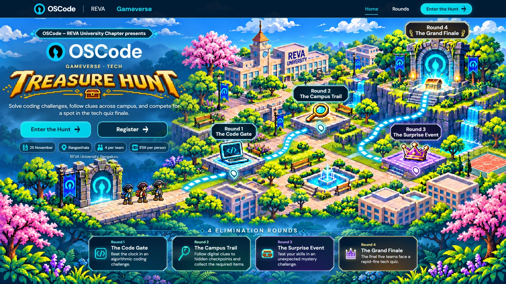
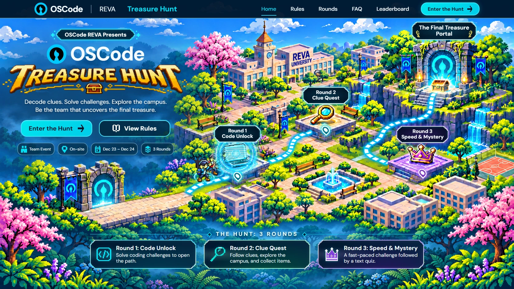

# OSCode Treasure Hunt · REVA

An interactive pixel-art landing page for an on-site team treasure hunt at REVA University. The campus map connects three challenges with a glowing path that leads to the final treasure portal.



<details>
<summary>Mobile view</summary>


</details>

## Run locally

Requirements are Node.js **20.9 or later** and npm. Use the included lockfile to install dependencies.

```bash
git clone https://github.com/Akif-Sait/oscodehunt.git
cd oscodehunt
npm ci
npm run dev
```

Open [http://localhost:3000](http://localhost:3000). In PowerShell, use `npm.cmd` in place of `npm` if your execution policy blocks the npm script.

To run the production build locally, stop any server using port 3000, then run the following commands.

```bash
npm run build
npm start
```

## Explore the campus

- The map includes the REVA entrance, three challenge landmarks, waterfalls, a fountain, and a final portal set into a cliff.
- The scene uses layered pixel art, mist, animated portal lighting, water reflections, birds, and drifting leaves that react to the pointer.
- The desktop composition fits the viewport. Phones get an illustrated, vertically scrolling layout with a compact menu and stacked round cards.
- Motion pauses when the tab is hidden. The page also respects the system’s reduced-motion preference.

| Round | Challenge |
| --- | --- |
| 1 · Code Unlock | Solve coding challenges to open the path. Look for the laptop at the first checkpoint. |
| 2 · Clue Quest | Follow clues across campus and collect items. Look for the magnifying glass. |
| 3 · Speed & Mystery | Take on a fast-paced challenge followed by a text quiz. Look for the crown. |

### Easter eggs

- **Wandering professor.** Watch the upper path between buildings. Click or tap the professor while he’s visible to change what he says in his speech bubble.
- **Fountain fish.** Watch the central fountain for a jump, or click or tap the basin to make the fish leap.
- **The Round 1 laptop.** The three backpackers wait by the entrance until a page event starts their walk. A second event makes the laptop pull them through cyan pixel rings and off the map.

### Trigger the adventurer animations

Open the homepage and enter these commands in the browser’s developer console.

```js
window.dispatchEvent(new Event('move to round1'));
window.dispatchEvent(new Event('round1jumanji'));
```

`move to round1` starts the walk to the laptop. `round1jumanji` queues the capture if the trio is walking, starts it immediately if they have arrived, or pulls them from the entrance if they’re still waiting there. With reduced motion enabled, the events update the characters’ positions without playing the animations. Reload the page to reset the trio.

<details>
<summary>Round 1 laptop effect</summary>



</details>

## Project structure

The homepage uses Next.js App Router and React. PixiJS renders the ambient particles, and CSS handles the scene layout, lighting, and sprite sequences.

| Path | What to edit |
| --- | --- |
| [`app/event-config.js`](app/event-config.js) | Displayed event dates, entry path, and header navigation. |
| [`app/pixel-scene.jsx`](app/pixel-scene.jsx) | Campus artwork and the position of each scene layer in the render order. |
| [`app/round-display.jsx`](app/round-display.jsx) | Round names, summaries, and map landmarks. |
| [`app/adventurer-party.jsx`](app/adventurer-party.jsx) | Adventurer routes and the two browser events. |
| [`app/campus-secrets.jsx`](app/campus-secrets.jsx) | The professor’s dialogue and fountain fish. |
| [`app/campus-lighting.css`](app/campus-lighting.css) | Portal glow, reflections, and foliage lighting. |
| [`public/art/`](public/art/) | Campus artwork, logos, title graphics, and sprite sheets. |

The current project implements the landing page at `/`. `/hunt`, `/rules`, `/rounds`, `/faq`, and `/leaderboard` are links reserved for future pages.
